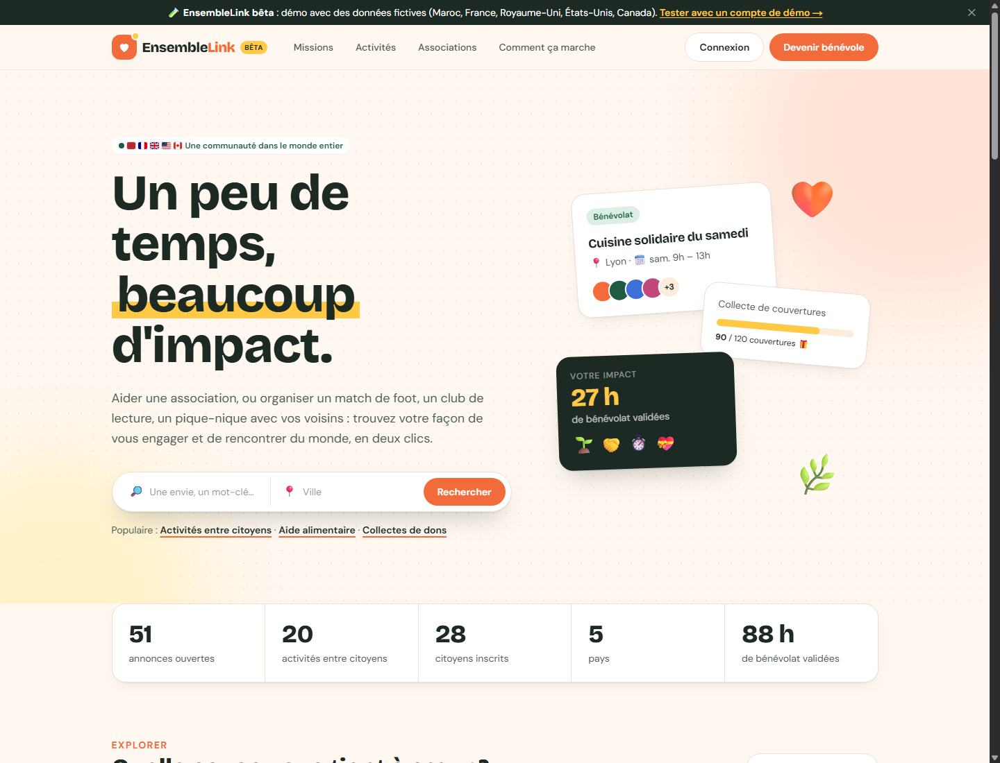
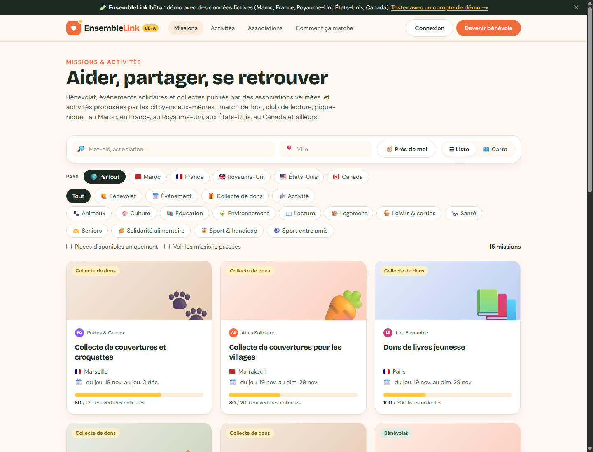
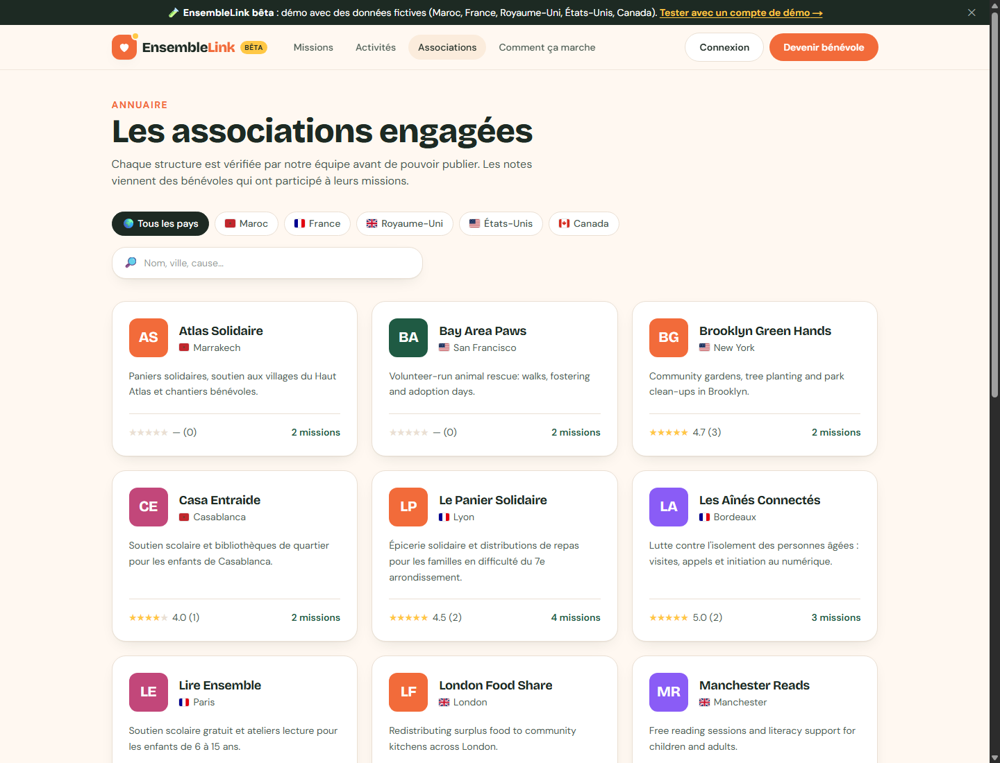

# EnsembleLink — agir ensemble

**EnsembleLink est une plateforme solidaire qui rapproche les personnes prêtes à s’engager et les associations qui ont besoin de soutien.** Elle transforme une envie d’aider en action concrète : trouver une mission, rejoindre une activité locale, soutenir une collecte ou organiser un moment avec ses voisins.

> Projet présenté dans ce dépôt : l’application front-end publique d’EnsembleLink.

**Voir l’application : [ensemblelink.vercel.app](https://ensemblelink.vercel.app/)**

## Le concept

L’engagement ne prend pas une seule forme. Une personne peut donner quelques heures à une association, participer à une collecte ou lancer un club de lecture dans son quartier. EnsembleLink réunit ces possibilités dans un même espace et facilite la rencontre entre les initiatives locales et les personnes qui souhaitent y prendre part.

La plateforme s’adresse à quatre profils :

- **Visiteurs**, qui découvrent les missions, les associations et les causes.
- **Citoyens et bénévoles**, qui trouvent des actions adaptées à leurs intérêts et suivent leurs engagements.
- **Associations**, qui présentent leur mission, publient des annonces et organisent la participation des bénévoles.
- **Administrateurs**, qui examinent les associations et contribuent à la confiance au sein de la communauté.

Les activités peuvent être publiées par des associations ou proposées par des citoyens : bénévolat, événement solidaire, collecte de dons, match de football, club de lecture ou sortie entre voisins. L’application présente des initiatives dans plusieurs pays et adapte les informations horaires au lieu de chaque activité.

## Le parcours dans l’application

### 1. Découvrir une façon d’agir

La page d’accueil introduit le projet et conduit vers les causes, les missions à venir et les activités de citoyens. La recherche permet de partir d’un besoin précis, comme une cause ou une ville.



*L’accueil met en avant l’idée centrale : chacun peut trouver une manière concrète de contribuer.*

### 2. Trouver une mission qui convient

La page **Missions et activités** regroupe les possibilités d’engagement. La personne peut rechercher par mot-clé ou ville, filtrer par pays, cause et type d’activité, limiter les résultats aux places disponibles et passer de la liste à la carte. La recherche de proximité peut utiliser sa localisation si elle l’autorise.



*Les filtres aident à parcourir les initiatives et à réduire les résultats aux besoins de chacun.*

Une mission possède une page de détail qui présente son objectif, son organisateur, son lieu, ses horaires et les modalités pour participer ou soutenir une collecte.

### 3. Découvrir les associations

L’annuaire aide à explorer les structures par pays et par recherche textuelle. Une fiche publique permet de comprendre les causes soutenues par l’association, de découvrir ses annonces et de consulter les retours de la communauté.



### 4. Passer à l’action et garder une trace

Une fois connecté, un citoyen peut rejoindre une mission, suivre sa candidature, échanger avec les organisateurs et consulter son historique. L’espace personnel valorise la participation avec des heures reconnues, des badges et des avis. Des recommandations de missions tiennent compte des causes préférées, des compétences et de la ville renseignées dans son profil.

Les associations disposent de leur propre espace pour publier des initiatives, examiner les candidatures, suivre les participations et organiser le pointage. L’administration dispose de vues dédiées à la vérification des structures et au traitement des signalements. La messagerie facilite la coordination entre les personnes impliquées.

## Ce que présente le front-end

- Une expérience publique pour comprendre le projet et explorer les initiatives.
- Une recherche avec filtres, carte et découverte par proximité.
- Des pages de détail pour les missions et les associations.
- Des parcours adaptés aux citoyens, associations et administrateurs.
- Un suivi des engagements et des recommandations personnalisées.
- Des outils d’échange et de coordination autour des activités.
- Une interface responsive pensée pour les écrans mobiles et de bureau.

Le front-end présente ces parcours et affiche les informations de la plateforme. Les actions personnalisées et les contenus dynamiques nécessitent un compte adapté et le service de données actif. Les espaces privés s’affichent selon le profil connecté.

## Captures d’écran

Les images intégrées à ce README sont des captures des écrans réels de l’application en production, avec les annonces et associations visibles au moment de la capture.

## Technologies

- **Next.js 16** et **React 19** pour l’application web.
- **TypeScript** pour les composants et les modèles d’interface.
- **Tailwind CSS 4** pour la mise en page et les styles adaptatifs.
- **Leaflet** pour la carte des missions.
- **QRCode React** pour l’affichage des QR codes de présence.

## Lancer le front-end en local

Depuis le dossier `frontend`, avec Node.js et npm installés :

```bash
npm install
npm run dev
```

L’application sera disponible à l’adresse [http://localhost:3000](http://localhost:3000). Les pages publiques peuvent être explorées sans connexion. Les espaces personnels et les données dynamiques nécessitent une source de données configurée et un compte approprié.

## Présenter le projet

Pour une démonstration rapide, commencer par expliquer le problème auquel répond EnsembleLink, puis suivre ce parcours :

1. **Accueil** : présenter la mise en relation entre initiatives solidaires et citoyens.
2. **Missions** : montrer les filtres, la carte et les différents types d’engagement.
3. **Association** : expliquer comment découvrir une structure et ses actions.
4. **Espace connecté** : illustrer le suivi de l’engagement ou l’organisation des bénévoles selon le rôle.

